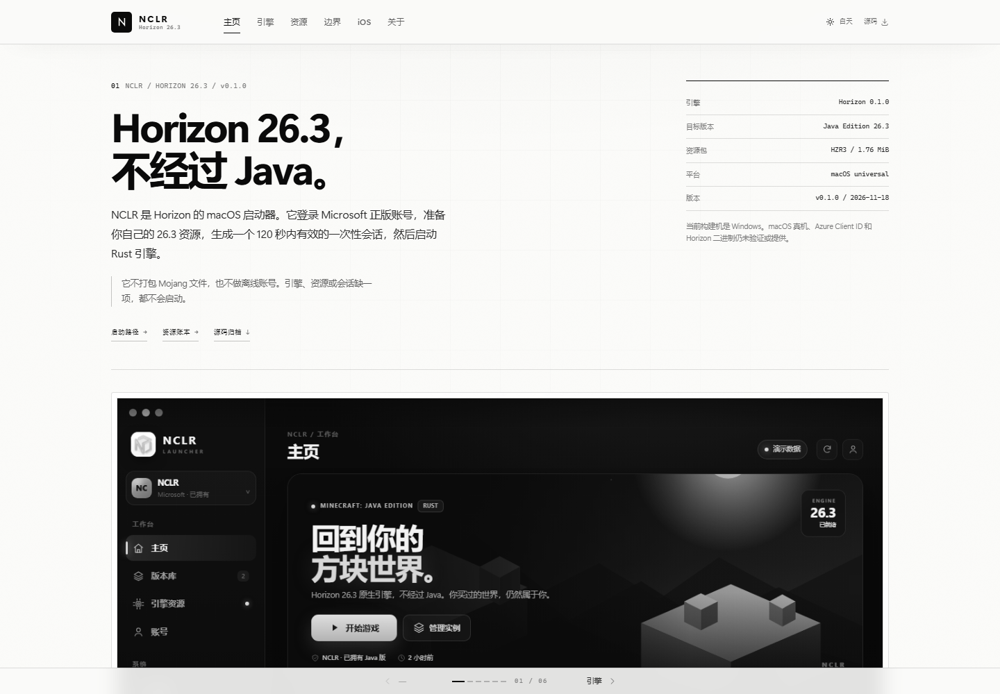
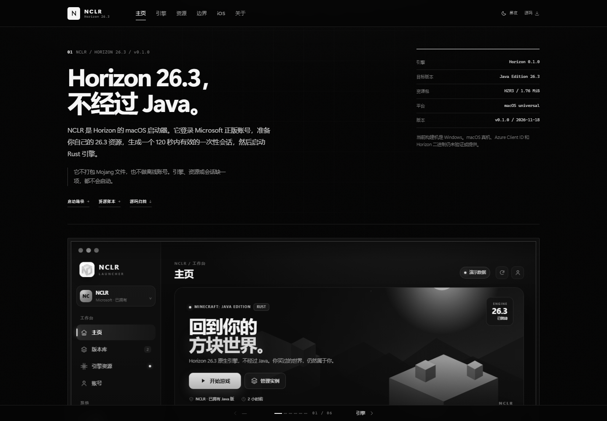
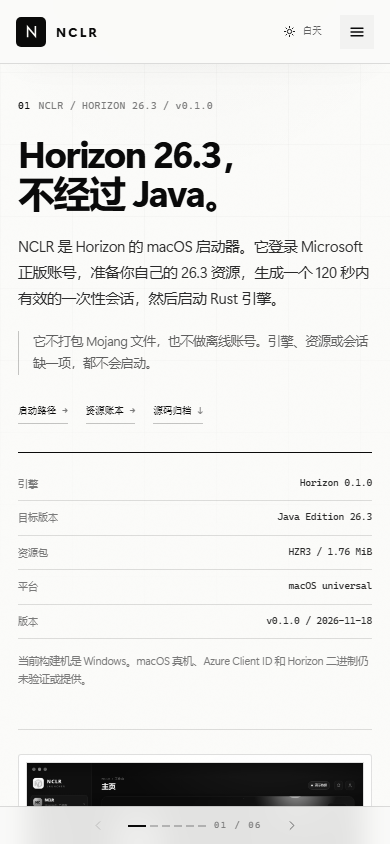

# NCLR — 黑白双主题站点

围绕本工作区 **NCLR / Horizon / route3** 文档做的七页静态站。  
纯黑白灰、细线、等宽标签、单张产品截图，以及一个克制的 3D 翻页。

## 预览

直接双击 `index.html`（哈希路由，无需构建、无需后端）。  
在本目录（`site/`）起一个本地静态服务器也可以：

```powershell
python -m http.server 4173
# 打开 http://127.0.0.1:4173/
```

## 仓库与页面

- 仓库：<https://github.com/NativeCraftLauncherRust/NCLR>
- 项目页：<https://nativecraftlauncherrust.github.io/NCLR/>
- 页面分支：`gh-pages`（根目录）
- 产品代码：`main` 分支；本站不改动 `main`
- 自定义域名：未配置（没有 `CNAME`）

本目录是 `gh-pages` 分支的内容。`index.html`、CSS、JS、图片和下载资源都使用相对路径；
`.nojekyll` 关闭 Jekyll，`404.html` 会把未知路径带回项目首页。

更新站点：替换本分支根目录的静态文件并 push，Pages 会自动重建。以后要独立域名，
在仓库根加 `CNAME`（内容为域名）并在 DNS 配置；现在使用组织 Pages 的项目路径。

## 页面

| 路由 | 内容 |
|---|---|
| `#/home` | 介绍、版本信息、产品截图、启动路径、资源、边界、iOS、索引 |
| `#/engine` | Horizon 引擎：启动链路、认证流程、终端日志 |
| `#/resources` | route3 资源账本：238.4 MiB → 1.76 MiB、逐字节对账 |
| `#/security` | 边界：所有权、一次性会话、第一版未完成项 |
| `#/ios` | M1–M6、IPA 数据、Documents 导入路径 |
| `#/about` | 作者、版本、三个来源、界面、下一版、链接 |
| `#/download` | L1.1 版本信息、组织仓库入口、安装顺序 |

## 设计

- **编辑式排版**：编号章节、细线分隔、等宽元数据、左对齐正文；不使用极光背景、
  悬浮图标、渐变标题、发光卡片、滚动揭示或跟随光标的动效。
- **图标**：NCLR 品牌图标使用同一张 3D N 图片（`nclr-icon-128.png`、`nclr-icon-512.png`），
  出现在顶栏、页脚、版本卡、404 和下载页；路径/流程图标仍是内联 SVG。
- **玻璃**：只保留在顶栏、分页器、截图外框和移动菜单上，用渐变与 `backdrop-filter`
  做出很轻的层次，不再给每张卡片加玻璃和阴影。
- **截图**：产品截图在源文件中已转成灰度；主题切换后仍保持黑白。

## 交互

- **白天 / 黑夜**：顶栏的文字开关（含图标），首次访问跟随系统
  `prefers-color-scheme`，之后写入 `localStorage`；同步 `theme-color`。
- **翻页**：View Transitions API；旧页面绕左缘翻出，顶栏和底部分页器保持固定。
  不支持时退化为淡入；`prefers-reduced-motion` 下改为短距离横向淡入。
- **导航**：顶栏、底部分页器、`←`/`→`、移动端左右滑动、浏览器前进/后退。
- **移动端**：不透明下拉菜单；焦点回到菜单按钮；320 / 390 宽无横向溢出。

## 结构

```text
site/
  index.html                 七个路由页面 + 内联 SVG 图标库
  404.html                    未知路径回项目首页
  robots.txt
  .nojekyll
  assets/css/style.css       基础布局与旧组件
  assets/css/theme.css       黑白主题变量与明暗覆盖
  assets/css/editorial.css   编辑式版式；覆盖颜色、间距、卡片、翻页
  assets/js/app.js           哈希路由、翻页、主题、菜单、键盘/滑动
  assets/img/                灰度产品截图 + NCLR 图标 / favicon / touch icon
  docs/                      预览图
```

## 技术说明

- 原生 HTML / CSS / JavaScript；无框架、无构建、无外部网络请求。
- 所有可见颜色为黑、白、灰；产品截图是灰度文件。
- 主题令牌在 `style.css` 的 `:root` 与 `html[data-theme="light"]`。
- 翻页：`::view-transition-old(root)` / `::view-transition-new(root)`，顶栏、
  分页器使用 `view-transition-name` 单独分组。
- 没有失效的装饰动效：旧的极光、轨道图标、光标光晕、数字滚动等代码路径已被停用。

## 内容来源

- `zrx-launcher/README.md`、`TASKS.md`、`docs/`（NCLR 产品、认证、边界）
- `repo/README.md`（iOS port，M1–M6）
- `route3/README.md`（HZR3 表包、转移账本）
- 产品截图来自 `zrx-launcher/docs/screenshot-*.png`，已转灰度

不是 Mojang / Microsoft 官方产品；Minecraft 是 Mojang Synergies AB 的商标。

## 预览图




